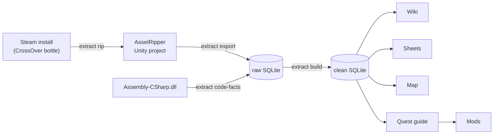

# Erenshor Data Mining

Extracts game data from the shipped build of the single-player MMORPG [Erenshor](https://store.steampowered.com/app/2382520/Erenshor/) and publishes it as the [wiki](https://erenshor.wiki.gg), Google Sheets, the [interactive map](https://erenshor.compendiums.org), and the companion mods AdventureGuide, InteractiveMapCompanion, Sprint, and JusticeForF7 for BepInEx and Lunaris.

## How it works



`extract rip` turns the installed game into a Unity project. `extract export` runs the editor scripts in `src/Assets/Editor/` in Unity batch mode and writes the raw database. `extract code-facts` adds values that the game hardcodes, read from the shipped assembly. `extract build` applies `mapping.json` and writes the clean database, whose schema is in `src/erenshor/application/processor/writer.py`. Everything that is published reads only the clean database.

The game variants `main`, `playtest`, and `demo` each have their own install, Unity project, and databases under `variants/<variant>/`. Select one with `-V`. Join data on `stable_key`, never on names, because names are not unique.

## Setup

Install these yourself:

- Nix, ideally with nix-direnv. The dev shell provides everything else, including Python, .NET, Node, and AssetRipper.
- Unity 2021.3.45f2, through Unity Hub.
- CrossOver with a Steam bottle that has each variant installed. Set `CROSSOVER_BOTTLE` if you have several bottles.

In the dev shell, run:

```sh
nix run .#bootstrap
pnpm exec lefthook install --reset-hooks-path
erenshor status
```

Copy `config.local.toml.example` to `.erenshor/config.local.toml` and fill in the wiki and Google credentials. The Thunderstore token goes in `.env` (see `.env.example`).

The dev shell must never build a toolchain from source. If entering it starts a compiler, stop it and run `nix build --dry-run 'path:.#devShells.aarch64-darwin.default'`. The plan must not contain `swift`, `dotnet-vmr`, or `dotnet-stage0`.

In a Git worktree, run the bootstrap again. A worktree that builds needs its own databases, images, and backups. Never symlink them to another checkout, because a build overwrites them. Copy them with `/bin/cp -c` (or `-cR`) and point the `images_output` and `backups` overrides in `.erenshor/config.local.toml` at the copies. To export, the worktree also needs its own copy of the Unity project, with its `Assets/Editor` link pointed at the worktree's `src/Assets/Editor`.

## Working on it

Run everything through `erenshor`, not through `pnpm`, `wrangler`, or `dotnet` directly. `erenshor --help` lists the command groups.

`erenshor test ci` runs what CI runs. `uv run pytest` alone does not, and the map tests use a fixture database whose schema differs from the real one.

After a game update, follow the [refreshing-game-data skill](.agent/skills/refreshing-game-data/SKILL.md). The other procedures are in [`.agent/skills`](.agent/skills/).

After changing a dependency by hand, regenerate its lock file and run `erenshor test dependency-state`.

Nix owns the pnpm version. Keep its toolchain on the patched 10.x line rather than the compatibility freeze, which can retain known vulnerabilities. After updating Nix inputs, run `nix run .#sync-pnpm-version` to align `package.json` before the dependency-state check.

## Rules

- Never edit the ripped game files under `variants/` or the installed game.
- Never edit generated output by hand, such as databases, `quest_guides/quest-guide.json`, or generated wiki pages. Change the generator.
- Fix missing or wrong data where it comes from: the export, the code facts, or a reviewed file such as `mapping.json` or `barriers.toml`. Do not patch it in one consumer.
- Ask before publishing to the wiki, the map, or the sheets. Do a dry run first.
- Keep the map's public URLs working: `/map` with the `layers` and `sel` parameters, WebSocket ports 18584 and 18585, and `/db/erenshor.sqlite`.
- Fix every failing check you come across, including ones that failed before your change.

## Troubleshooting

- `erenshor status` shows tool paths, installs, and database state. Logs are in `.erenshor/logs/` and `variants/<variant>/logs/`.
- If Git hooks fail with exit 127, your Git client runs them outside the dev shell. Hook jobs that need project tools go through `scripts/with-dev-env.sh`.
- If the live map does not connect, check that the game runs InteractiveMapCompanion.

## License

MIT. See [LICENSE](LICENSE). This is an unofficial fan project and is not affiliated with the developer of Erenshor.
