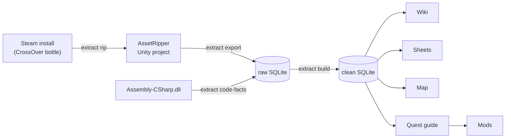

# Erenshor Data Mining

Game data for the single-player MMORPG [Erenshor](https://store.steampowered.com/app/2382520/Erenshor/), extracted from the shipped build and published as a wiki, spreadsheets, an interactive map, and in-game companion mods.

[Wiki](https://erenshor.wiki.gg) · [Interactive map](https://erenshor.compendiums.org)

## What it publishes

- The wiki at `erenshor.wiki.gg`: generated articles, Lua data modules for links and tooltips, and the modules and templates in `wiki/`. Editors write the article text. The pipeline writes the data.
- Google Sheets, with one tab per query in `src/erenshor/application/sheets/queries/`.
- The interactive map at `erenshor.compendiums.org`, a SvelteKit and deck.gl site with every spawn, resource, and location. It also shows live positions of the characters in your zone, which the companion mod sends.
- The companion mods AdventureGuide (quest guide and navigation), InteractiveMapCompanion (live map data), Sprint, and JusticeForF7. Each builds for BepInEx and Lunaris. MapTileCapture is an internal tool.

All of them read the clean database of the current shipping build.

## How it works



1. `extract rip` turns the installed game into a Unity project with AssetRipper. `extract export` then runs the editor scripts in `src/Assets/Editor/` in Unity batch mode. They copy the Unity assets into tables in `variants/<variant>/erenshor-<variant>-raw.sqlite` without merging or filtering them.
2. `extract code-facts` reads values that the game hardcodes, such as drop chances and level limits, from the shipped assembly into the raw database. It fails when `src/tools/CodeFacts/specs/behaviour-coverage.json` does not list a script that reads or changes quests, items, or other progression state. After a game update, this makes you review new scripts before the clean build.
3. `extract build` applies `mapping.json` (display names, exclusions, and overrides with a reason), merges duplicate characters, derives columns, and writes `variants/<variant>/erenshor-<variant>.sqlite`. The schema is in `src/erenshor/application/processor/writer.py`.
4. The wiki generators, sheet queries, map build, and quest guide compiler read only the clean database.

### Concepts

- Every entity has a `stable_key`, such as `item:head - 7 - arcanist cap`. Join data on these keys. Names are not unique. A character placed in a scene under a name that another character also uses gets its coordinates in its key.
- The variants `main` (Steam app 2382520), `playtest` (3090030), and `demo` (2522260) each have their own install, Unity project, and databases. Select one with `-V`. The wiki shows only the current shipping build.
- The clean build gives each character an encounter tier: `npc`, `enemy`, `elite`, or `boss`. Override a tier in `mapping.json` with a reason.
- The wiki bot owns the data modules. Editors own the prose, notes, and strategy, and refreshes keep them. When the export misses a fact, add it to code facts or `mapping.json`, so that every consumer gets it. Do not add it to one article's parameters.
- Some characters are spawned by game scripts at run time. The dynamic-spawn catalog in `src/Assets/Editor/ExportSystem/AssetScanner/` lists each spawning script, and the export fails on a script it does not list.
- `src/erenshor/application/processor/item_provenance.py` decides where each item comes from and what it is used for. Put queries over the source tables there, and keep them out of the output code. Before publishing, compare its input coverage with each output's provenance manifest.
- The clean build records what a player needs before something becomes available: gates in `gate_conditions`, barriers, script-completed quests, travel between zones, rain and other world state, and faction standing. `quest_routes` and the `progression_*` tables combine these into a requirement graph, ordered into playthrough tiers. `erenshor progression show <key>` explains one node, and `--gaps` lists nodes that have no way or tier. When a step is wrong or missing, add the missing fact to the export, the code facts, or a reviewed file. Do not patch it in a consumer. The rules are in the `progression-requirements` and `quest-routes` specs and the `model-progression-mechanics` change.
- Each door or other object that a game script opens needs a record in `barriers.toml`, with the targets it guards and the in-game check that confirmed them. The comment at the top of that file explains the fields and checks. The build fails when a record is missing or out of date.
- To exclude a zone line that no player can reach, add a `zoneline:` rule with `is_usable` 0 and a reason to `mapping.json`, after checking the line in the game. A rule cannot make a line usable.

## Repository layout

| Path | Contents |
| --- | --- |
| `src/erenshor` | The `erenshor` CLI: extraction, clean build, wiki, sheets, maps, mods, tests. |
| `src/Assets/Editor` | Unity editor scripts for the raw export. |
| `src/tools` | Native analyzers (CodeFacts, ExportSurface) and maintenance scripts. |
| `src/maps` | The interactive map site. |
| `src/mods` | The companion mods and their packaging. |
| `wiki` | Wiki pages kept in the repository: Lua modules, templates, content pages, and gadgets. |
| `wiki-dev` | A local MediaWiki stack for testing wiki changes. |
| `quest_guides` | Generated and hand-written quest guide data for AdventureGuide. |
| `tests` | Unit, contract, system, and data tests. |
| `openspec` | Requirements (`specs/`) and the reasoning behind each change (`changes/`). |
| `.agent/skills` | Step-by-step procedures for recurring work. |

`variants/` (game files, Unity projects, databases, generated output) and `.erenshor/` (local configuration and logs) are not tracked.

## Getting started

The Nix flake's dev shell provides Python and uv, the .NET SDKs, Node and pnpm, AssetRipper, and `sqlite3`. With nix-direnv it loads when you enter the working tree. Otherwise run `nix develop`. The commands below assume the dev shell.

```sh
nix run .#bootstrap                  # locked JavaScript packages and .NET tools
pnpm exec lefthook install --reset-hooks-path
erenshor status                      # tool paths, installs, and database state
```

The shell never builds a toolchain from source. If entering it starts a compiler, stop it and run `nix build --dry-run 'path:.#devShells.aarch64-darwin.default'`. The plan must not contain `swift`, `dotnet-vmr`, or `dotnet-stage0`.

The shell does not provide these:

- Unity 2021.3.45f2, installed through Unity Hub. `extract export` refuses other versions.
- CrossOver with a Steam bottle that has each variant installed. The CLI finds an install by its Steam app ID. Set `CROSSOVER_BOTTLE` if you have several bottles.
- Credentials. Copy `config.local.toml.example` to `.erenshor/config.local.toml` and fill in the wiki bot and interface logins and the path of the Google service account key. Put the Thunderstore token in `.env` (see `.env.example`). `config.toml` has the tracked defaults, and an unknown key is an error.

### Git worktrees

Run the bootstrap in each new worktree. Python imports the checkout that contains the current directory, even inside another checkout's dev shell, and the CLI stops if the two differ. After a dev-shell update, enter the shell again. This prints which checkout Python imports:

```sh
python -c 'import erenshor; from erenshor.infrastructure.config import get_repo_root; print(erenshor.__file__); print(get_repo_root())'
```

A worktree that runs builds needs its own raw and clean databases, image catalog, and backups, because a build overwrites them. Do not symlink them to another checkout. On macOS, copy them with `/bin/cp -c`, or `/bin/cp -cR` for directories. These make APFS clones, which the dev shell's GNU `cp` cannot. Then point `images_output` and `backups` in `.erenshor/config.local.toml` at the copies. `extract build` refuses to write into another checkout.

A worktree that only reads data can symlink the Unity project. To export, give the worktree its own copy and point the copy's `Assets/Editor` link at the worktree's `src/Assets/Editor`. The link still points at the checkout the project came from, so without this the export runs that checkout's scripts.

## Common work

| Command | What it does |
| --- | --- |
| `erenshor extract packages` | Restores the Unity editor packages, once per checkout. |
| `erenshor extract rip` / `export` / `code-facts` / `build` | Runs the pipeline steps above. |
| `erenshor extract changes` | Compares the clean database with a backed-up build or a saved clean database. Review its report after every data change. |
| `erenshor wiki fetch` / `generate` | Fetches live articles and merges regenerated data into them. |
| `erenshor wiki generate-lua` / `deploy-repo-pages` | Generates the Lua data modules, and deploys the modules and templates in `wiki/`. Each edit checks the page's current revision and keeps rollback data. |
| `erenshor sheets deploy` | Publishes the sheet queries. |
| `erenshor maps dev` / `build` / `preview` / `deploy` | Develops, checks, and deploys the map. |
| `erenshor publish prepare` / `apply` / `status` / `resume` | Publishes selected wiki pages, map builds, and sheet tabs from one reviewed plan. |
| `erenshor mod build` / `deploy` / `thunderstore` | Builds, installs, and packages the mods. `-V` selects the game install, `--loader` the loader. |
| `erenshor guide export-mod` | Writes `quest_guides/quest-guide.json`, the quest data that AdventureGuide embeds. |
| `erenshor eval run '<C#>'` | Runs code in the running game through HotRepl. |
| `erenshor capture run` | Captures map tiles through MapTileCapture. |

Run every subsystem through `erenshor` instead of calling `pnpm`, `wrangler`, or `dotnet` directly. `erenshor <group> --help` lists the options.

### Publishing several targets

Use `publish` instead of running publishing commands one after another. `publish prepare` writes the selected titles, map targets, and sheet tabs into a new run directory without publishing anything. Read its `review-summary.json` and the files it links to, then run `erenshor --dry-run publish apply`. A live `apply` or `resume` needs a person's approval of the reviewed digest. Put changed editor prose in a separately reviewed replacement file in the variant directory, and include its digest in the selection.

The run stops at the first failure. Keep the run directory, read `publish status`, and sort out what happened before you `resume`. Nothing is rolled back automatically. The `ordered-publishing` spec in the `plan-ordered-publishing` change lists each check and what it cannot catch.

### Game updates

After a Steam update, back up, rip, export, extract code facts, and build, then check and deploy each consumer. The [refreshing-game-data skill](.agent/skills/refreshing-game-data/SKILL.md) gives the order and the checks between steps.

### Rules for changes

- Never edit the decompiled game scripts under `variants/<variant>/unity/ExportedProject/Assets/Scripts/`, other ripped assets, or the installed game.
- Never edit generated output by hand: databases, `quest_guides/quest-guide.json`, map builds, captured tiles, generated wiki pages, or mod metadata. Change the generator and regenerate.
- Deploys to the wiki, the map, or the sheets need the maintainer's approval. Do a dry run of each deploy first.
- Keep the live map's old URLs and ports working: `/map` with the `layers` and `sel` parameters on both hosts, WebSocket ports 18584 and 18585, and `/db/erenshor.sqlite`.
- The Nix dev shell must never build a toolchain from source.
- Fix every failing check you come across, including ones that failed before your change.
- Read the relevant subsystem skill before changing that subsystem.
- Wiki work follows the plan in the OpenSpec change `adopt-data-backed-wiki`. Read its design before changing anything on the wiki, and track wiki work only in OpenSpec.

### Design principles

- Show where data comes from and report errors on the page instead of hiding them.
- Follow the conventions of MediaWiki, the web, and the game instead of inventing a separate look.
- Preview before writing, and stop before anything destructive.
- Meet WCAG 2.2 AA, and make everything usable from the keyboard.

## Testing

```sh
erenshor test ci                     # what CI runs: static checks, unit, contract, maps, mods
erenshor test unit                   # one leaf
erenshor -V main test release        # adds main data, clean wiki parity, real builds, package checks
```

Running `uv run pytest` alone does not match CI. The maps leaf prerenders the site against the fixture database in `src/maps/tests/fixtures/`, whose schema differs from the real one, so a query that works on the real database can fail in CI. `erenshor test wiki` needs the local MediaWiki stack described in `wiki-dev/README.md`. Each leaf writes a report to `artifacts/test-reports/`.

## Dependencies

| Graph | Versions | Lock |
| --- | --- | --- |
| Nix | `flake.nix` | `flake.lock` |
| Python | `pyproject.toml` | `uv.lock` |
| pnpm | `package.json` files | root `pnpm-lock.yaml` |
| NuGet | `src/Directory.Packages.props` | each project's `packages.lock.json` |
| .NET tools | `.config/dotnet-tools.json` | exact versions |
| GitHub Actions | workflow `uses:` | full commit SHAs |

Renovate updates everything except Nix. The private `glockyco/dependency-automation` workflow updates Nix and the pnpm version in `flake.nix`, and opens a pull request. After changing a dependency by hand, regenerate its lock (`uv lock`, `pnpm install --lockfile-only`, `dotnet restore --force-evaluate` once per mod loader, or `nix flake update` and `nix run .#sync-pnpm-version`) and run `erenshor test dependency-state`.

Keep NuGet feeds and package source mappings next to the central package versions. Renovate's restore configuration and the project builds then use the same sources.

## Troubleshooting

- `erenshor status` shows tool paths, installs, and database state. Logs are in `.erenshor/logs/` and `variants/<variant>/logs/`.
- If Git hooks fail with exit 127, your Git client runs them outside the dev shell. Hook jobs that need project tools go through `scripts/with-dev-env.sh`.
- If the live map does not connect, check that the game runs InteractiveMapCompanion, which serves `ws://localhost:18585`.

## Further reading

- [`openspec/specs`](openspec/specs/) describes what the pipeline and its outputs must do. Each change under [`openspec/changes`](openspec/changes/) explains why it was made.
- [`.agent/skills`](.agent/skills/) has the procedures for game updates, exports, code facts, the wiki, sheets, the map, tile capture, mods, and inspecting the running game.

## License

MIT. See [LICENSE](LICENSE).

Erenshor Data Mining is an unofficial fan project and is not affiliated with the developer of Erenshor.
